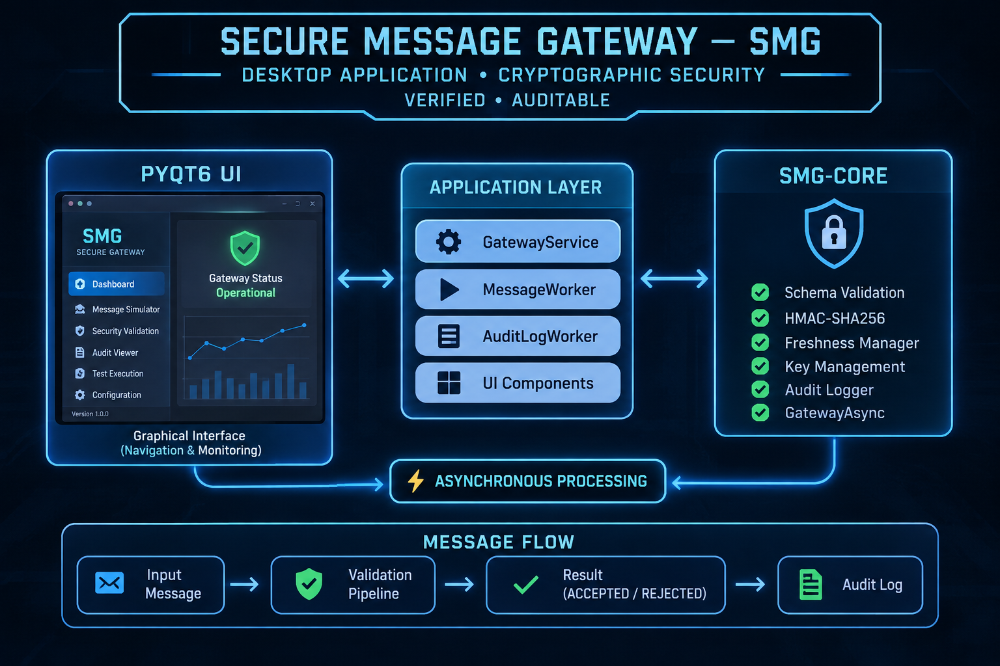
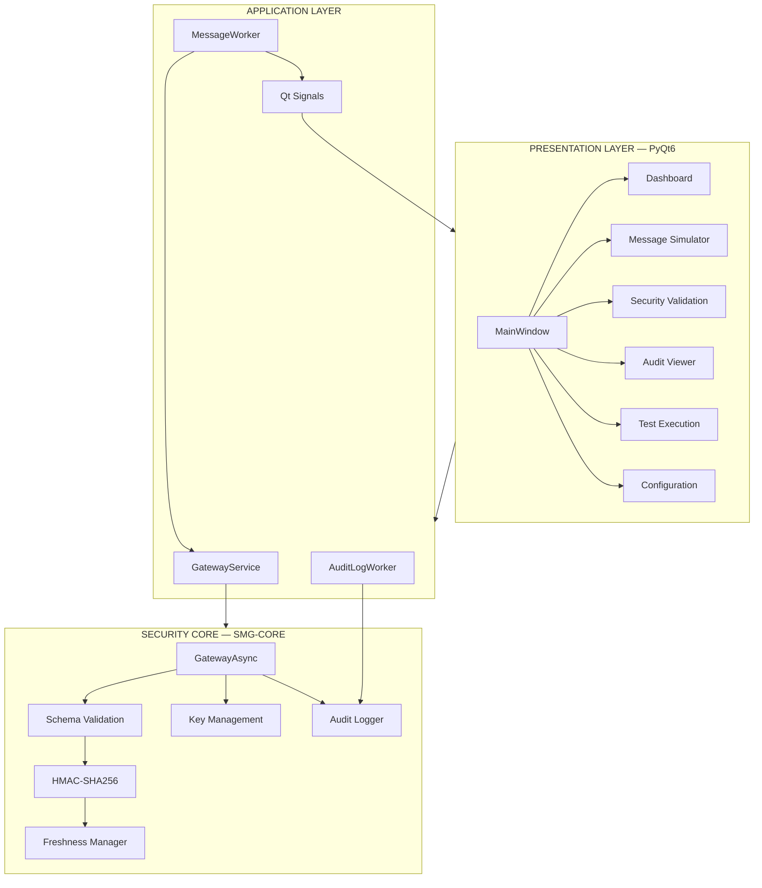
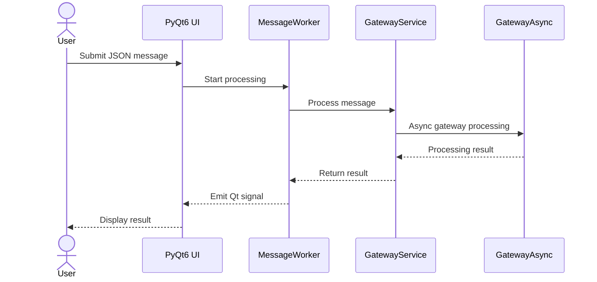

 <div align="center">



*Note: This architecture illustration was generated with the assistance of AI and is used for documentation purposes.*

**A Python Security Gateway with an Integrated PyQt6 Desktop Application**

[](https://github.com/ingDin/secure-message-gateway/actions)
[](https://github.com/ingDin/secure-message-gateway)
[](https://github.com/ingDin/secure-message-gateway/releases/tag/v1.0.0)
[](https://www.python.org/)

</div>

---

## 🔐 1. Overview

**Secure Message Gateway (SMG)** is a Python-based message security system that combines a cryptographic processing engine with a graphical desktop application.

The system provides a controlled environment for generating, processing, validating, and auditing messages.

Instead of interacting directly with the gateway's internal modules, users can operate the system through a PyQt6 desktop interface.

### Main capabilities

- **Message Integrity** — HMAC-SHA256 authentication.
- **Schema Validation** — strict JSON message structure validation.
- **Anti-Replay Protection** — monotonic counter and freshness validation.
- **Key Management** — key loading, archival, and rotation support.
- **Asynchronous Processing** — background execution without blocking the UI.
- **Audit Logging** — structured JSON event records.
- **Desktop Monitoring** — graphical access to gateway activity and validation results.
- **Automated Testing** — functional tests executed through pytest or the desktop interface.

---

## 🖥️ 2. Desktop Application

The desktop application is built with **PyQt6** and provides a graphical control and monitoring interface for the gateway.

It is organized into six main pages.

### 2.1 Dashboard

<text color="secondary" size="sm">Gateway overview and activity monitoring</text>

The Dashboard provides a quick overview of gateway activity.

- Accepted Messages
- Rejected Messages
- Validation Success Rate
- Audit Events
- Message Processing Activity
- Security Component Status

The dashboard reads activity information from the configured audit JSON file and refreshes its metrics periodically.

### 2.2 Message Simulator

<text color="secondary" size="sm">Message generation and processing</text>

The Message Simulator allows users to interact with the gateway without writing additional scripts.

Available operations:

- Generate an authenticated test message.
- Edit the generated JSON payload.
- Submit a message for processing.
- View whether the message was accepted or rejected.
- Inspect the processing result and rejection reason.

Message generation and processing are separate operations. Generating a message does not automatically submit it to the gateway.

### 2.3 Security Validation

<text color="secondary" size="sm">Security validation status</text>

This page displays the results reported by the message-processing workflow.

It presents the status of:

- JSON Schema Validation
- HMAC Verification
- Freshness Validation

The validation sequence is:

`Schema → HMAC → Freshness`

The page displays validation results; it does not independently execute the security pipeline.

### 2.4 Audit Viewer

<text color="secondary" size="sm">Event inspection and audit records</text>

The Audit Viewer provides access to recent gateway events.

Features:

- Load the latest 100 valid JSON records.
- Search through the loaded records.
- Refresh audit data.
- Double-click a record to inspect its JSON payload.

Audit file reading is performed in a background worker to keep the interface responsive.

### 2.5 Test Execution

<text color="secondary" size="sm">Functional test execution</text>

The Test Execution page allows users to run the project's pytest suite directly from the desktop application.

It displays:

- Total tests
- Passed tests
- Failed tests
- Skipped tests
- Individual test results

Tests execute in a separate thread, so the desktop interface remains responsive.

### 2.6 Configuration

<text color="secondary" size="sm">Gateway configuration management</text>

The Configuration page provides a graphical way to manage gateway settings.

Configuration categories:

| Category | Settings |
|---|---|
| General | Version and environment |
| Cryptography | Key files, archive and rotation settings |
| Freshness | Counter file, initial counter and increment limits |
| Logging | Log file path |
| Audit | Audit logging enablement and output path |

The interface supports reloading and saving configuration.

Configuration validation checks required values, paths, cryptographic settings, and freshness limits before saving.

---

## 🏗️ 3. System Architecture

The project uses a layered architecture that separates the graphical interface, application coordination, and security processing.

This separation makes the application easier to maintain, test, and extend.

### 3.1 Architecture Overview



### 3.2 Presentation Layer — Desktop UI

The presentation layer is responsible for everything the user sees and interacts with.

Main responsibilities:

- Display application pages.
- Collect user input.
- Present message-processing results.
- Display gateway metrics and security status.
- Allow configuration management.
- Trigger operations through application-level services.

The `MainWindow` coordinates the main interface using a sidebar, top bar, and stacked page layout.

Individual UI components communicate through Qt signals and slots.

**Important:** The UI does not implement cryptographic validation itself. It delegates processing to the application layer.

### 3.3 Application Layer — Intermediate Layer

The application layer connects the desktop interface to the security gateway.

It contains the service adapter and background workers.

**GatewayService**

Acts as the adapter between the UI and the gateway core.

Responsibilities:

- Load gateway configuration.
- Resolve configured file paths.
- Initialize the gateway when needed.
- Expose the asynchronous message-processing operation.

**MessageWorker**

Executes message processing outside the main UI thread.

Its workflow:

1. Receives a message from the application.
2. Calls `GatewayService`.
3. Runs the asynchronous processing operation using `asyncio`.
4. Emits the result or an error through Qt signals.

**AuditLogWorker**

Reads audit records in the background.

It loads recent JSON entries without making the desktop interface wait for file operations.

**Qt Signals and Slots**

Workers communicate their results back to the UI through signals.

This allows the interface to update its pages when processing finishes.

### 3.4 Security Layer — SMG-CORE

The security core contains the actual message-processing logic.

It is responsible for:

- JSON Schema validation.
- HMAC-SHA256 verification.
- Freshness and counter validation.
- Key management.
- Audit event generation.
- Asynchronous gateway orchestration.

The gateway core remains independent of the graphical interface.

This means the same processing functionality can be accessed through the application service layer without placing security logic inside UI components.

### 3.5 Why Use Background Workers?

Message processing and audit file reading can take time.

Running these operations directly on the UI thread could make the application unresponsive.

SMG uses Qt worker threads for these operations.



The UI remains available while the worker executes the operation.

---

## 🔄 4. Message Processing Pipeline

Every submitted message passes through the gateway's security pipeline.

```text
             INPUT MESSAGE
                   │
                   ▼
          JSON SCHEMA VALIDATION
                   │
                   ▼
            HMAC VERIFICATION
                   │
                   ▼
          FRESHNESS VALIDATION
                   │
                   ▼
           GATEWAY PROCESSING
                   │
             ┌─────┴─────┐
             ▼           ▼
          ACCEPTED     REJECTED
             │           │
             └─────┬─────┘
                   ▼
              AUDIT EVENT
```

### Validation Components

| Component | Responsibility |
|---|---|
| Schema Validator | Checks message structure |
| HMAC Engine | Verifies message integrity |
| Freshness Manager | Checks counter progression and replay protection |
| Key Manager | Handles key loading and rotation |
| Audit Logger | Records processing events |

A message that fails validation is rejected, and the corresponding result is made available to the application.

---

## 🔄 5. Freshness and Anti-Replay Protection

The freshness subsystem uses a monotonic counter to detect invalid message progression and replay attempts.

The counter is stored in the configured freshness file.

Its initial value depends on:

- The configured `initial_counter`.
- The existing counter file.
- The `reset_on_start` policy.

### Counter Initialization

If the counter file exists and is loaded, the next incoming message must respect the configured increment limits.

For example:

```json
{
  "counter": 37
}
```

With:

```json
{
  "min_increment": 1,
  "max_increment": 5
}
```

The next valid counter must be between `38` and `42`.

### Bootstrap Mode

If the counter file does not exist:

- `initial_counter: "auto"` allows the first incoming message to establish the counter.
- A numeric `initial_counter` initializes the counter from configuration.

After the counter has been established, increment validation applies to subsequent messages.

If `reset_on_start` is enabled, the existing counter file is deleted during startup and the counter is initialized again according to the configured initial value.

---

## 📝 6. Audit Logging

SMG records gateway activity using JSON Lines (`JSON`).

Each line represents one structured event.

Example:

```json
{
  "timestamp": "2026-09-29T21:03:38.850937+00:00",
  "event": "MESSAGE_ACCEPTED",
  "payload": {
    "id": 1,
    "counter": 1,
    "msg": "auto-msg-1"
  }
}
```

Typical event information includes:

- **Timestamp** — event time.
- **Event** — operation result or event type.
- **Payload** — message metadata.

The Dashboard uses the audit file for activity metrics, while the Audit Viewer provides access to recent records.

The audit file is also useful for external inspection and analysis with tools such as Python or `jq`.

---

## 📦 7. Installation

### Requirements

- Python 3.10 or newer.
- pip.
- A supported operating system for PyQt6.

### Clone the Repository

```bash
git clone https://github.com/ingDin/secure-message-gateway.git
cd secure-message-gateway
```

### Create a Virtual Environment

```bash
python -m venv .venv
```

Activate it:

**Windows**

```bash
.venv\Scripts\activate
```

**Linux / macOS**

```bash
source .venv/bin/activate
```

### Install Dependencies

```bash
pip install -e ".[dev]"
```

This installs the project and its development dependencies defined in `pyproject.toml`.

---

## 🚀 8. Running the Application

Start the desktop application from the project root:

```bash
python src/main.py
```

Alternative launch command:

```bash
cd src
python -m desktop_app.main
```

The application loads its settings from:

```text
config/config.json
```

### First-Time Configuration

Before processing messages:

1. Open the Configuration page.
2. Check the selected environment.
3. Configure the required key file paths.
4. Review freshness and counter settings.
5. Check audit and logging paths.
6. Save the configuration.

Make sure the required key material exists and is valid for the selected environment.

If the freshness counter file does not exist and `initial_counter` is set to `"auto"`, initialize the counter through an accepted incoming message before relying on generated test messages that require an established counter.

---

## 🧪 9. Running Tests

Run the functional test suite from the project root:

```bash
pytest
```

The desktop application also provides a **Test Execution** page for running the same test suite and displaying individual results.

### Test Categories

- **Unit Tests** — individual component behavior.
- **Integration Tests** — interactions between gateway components.
- **Acceptance Tests** — end-to-end message-processing behavior.

The project also includes a GitHub Actions workflow for continuous integration.

> The current test suite focuses on functional correctness. Performance, load, stress, and concurrency testing are not included.

---

## 🛠️ 10. Technology Stack

| Technology | Purpose |
|---|---|
| Python 3.10+ | Main programming language |
| PyQt6 | Desktop graphical interface |
| asyncio | Asynchronous execution |
| cryptography | Cryptographic operations |
| jsonschema | JSON Schema validation |
| aiofiles | Asynchronous file operations |
| python-json-logger | Structured logging |
| pytest | Automated testing |
| GitHub Actions | Continuous integration |

---

## 📁 11. Project Structure

```text
secure-message-gateway/
│
├── config/
│   └── config.json
│
├── src/
│   ├── desktop_app/
│   │   ├── pages/
│   │   ├── components/
│   │   ├── workers/
│   │   └── main.py
│   │
│   ├── secure_gateway/
│   │
│   └── main.py
│
├── tests/
│
├── .github/
│   └── workflows/
│
├── pyproject.toml
└── README.md
```

*This overview shows the main project areas; additional modules and supporting files are omitted.*

---

## 🔐 12. Security and Design Principles

SMG is designed around separation of responsibilities.

- **Separation of Concerns** — UI, application coordination, and gateway processing are kept separate.
- **Cryptographic Integrity** — HMAC-SHA256 is used for message authentication.
- **Replay Protection** — freshness checks use monotonic counter progression.
- **Structured Auditing** — gateway events are recorded in JSON format.
- **Responsive UI** — background workers handle time-consuming operations.
- **Testability** — gateway logic and desktop operations are organized into separate components.

The desktop interface provides visibility and control, while the gateway core remains responsible for security decisions.

---

## 13. License

This project is distributed under the **MIT License**.

See the [LICENSE](https://github.com/ingDin/secure-message-gateway/blob/main/LICENSE) file for details.

## 14. Disclaimer and Intended Use

This project is provided for **educational, experimental, and demonstration purposes only**.

Secure Message Gateway is a learning playground inspired by security concepts, patterns, and practices commonly found in the software industry. It is intended to demonstrate concepts such as message signing, HMAC validation, schema validation, audit logging, and security-related workflows.

**This project is not intended or certified for production use, nor should it be relied upon to protect sensitive data, systems, or communications.**

The software is provided "AS IS", without warranties or guarantees of any kind, express or implied. The author makes no guarantees regarding its security, reliability, correctness, or suitability for any particular purpose.

To the maximum extent permitted by applicable law, the author shall not be held liable for any damages, data loss, security incidents, or other consequences arising from the use or inability to use this software.

Users are responsible for evaluating the software and deciding whether it is appropriate for their intended use.